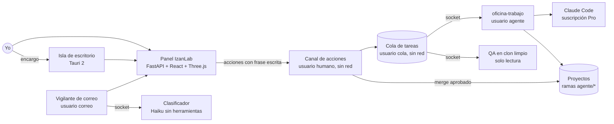

# Oficina Digital

Una oficina de agentes de IA que trabaja para mí en mi propio PC: encargo una tarea, un Arquitecto escribe la especificación, yo la apruebo, un Desarrollador la programa en una rama, QA la revisa, y yo decido el merge. Todo corre aislado dentro de WSL2 (Ubuntu), con las cuotas de mi suscripción de Claude y **sin pagar nunca por uso de API**.

La vigilo desde un panel web y desde una «isla» de escritorio que se despliega cuando algo me necesita.

> Proyecto personal en marcha. El código está pensado para mi máquina (WSL2 con Ubuntu 26.04, usuarios y rutas concretas): sirve como referencia, no como instalador listo para usar. Las IPs, los identificadores de mis dispositivos y los datos personales se han sustituido por valores de ejemplo.

## Qué hace

- **Cola de tareas con roles:** Investigador («¿ya existe?»), Arquitecto, Desarrollador, QA y Triage. Cada rol tiene sus herramientas permitidas y su modelo (Haiku, Sonnet u Opus) según la complejidad y la cuota que quede.
- **Aprobaciones humanas donde importan:** las especificaciones, los merges a `main`, subir a GitHub y publicar exigen una frase escrita, atada al commit exacto que se aprobó.
- **Cuota sin sorpresas:** la cola lee el uso real de la suscripción en cada sesión, se pausa sola al 90 % (5 horas) o al 70 % (semana) y se para en seco si detecta cualquier pago por uso.
- **Panel IzanLab:** FastAPI y React, con una oficina en 3D (Three.js) donde cada agente aparece trabajando, pensando o esperando, un tablero Kanban, el rack de servicios y las aprobaciones pendientes.
- **Isla de escritorio:** una cápsula en Tauri 2 que se queda como una raya en lo alto de la pantalla y se despliega con el ratón o cuando algo te necesita. Desde ella se habla con Triage, se responden las preguntas de los agentes y se encargan webs.
- **Creador de webs:** plantillas web (HTML estático y Astro) con SEO, accesibilidad, cabeceras de seguridad, textos legales y tests incluidos, y una vista local del resultado construida en un contenedor sin privilegios.
- **Vigilante de correo:** ordena Gmail con reglas fijas y, para lo que no encaja, con Haiku sin herramientas; avisa en la isla de los correos importantes. Nunca borra ni envía.
- **Copias cifradas** con restic y segunda opinión opcional de otro modelo (Gemini, por Antigravity CLI) en repos de prueba.

## Cómo está montada



| Carpeta | Qué hay |
|---|---|
| `fase-0` … `fase-5` | La Oficina por fases: base del sistema, bóveda de Obsidian con historial, acceso remoto por Tailscale y Syncthing, plantillas y entregas, la cola y sus roles, y la segunda opinión. Cada fase trae su instalador y su `verificar.sh`. |
| `cola/` | `oficina-trabajo` (ejecuta cada tarea como `agente`), `oficina-claude` (el lanzador que impide pagar por uso), investigación previa, instaladores y pruebas aisladas. |
| `panel/` | Backend FastAPI (solo lectura, todo lo que escriben los agentes se trata como no fiable), frontend React/Vite con la oficina 3D y la isla, canal de acciones y baterías de ataques. |
| `isla/` | La carcasa de escritorio en Rust (Tauri 2), con su lista cerrada de órdenes permitidas. |
| `correo/` | Vigilante de Gmail, clasificador y sus pruebas con un Gmail y un Claude falsos. |
| `copias/` | Copias cifradas con restic y su réplica al portátil. |
| `plantillas/` | Plantillas de proyecto (web estática y Astro) con sus tests. |
| `docs/` | Diseños aprobados del creador de webs y del vigilante de correo. |

## Seguridad

La regla de fondo: **los agentes no tienen credenciales**. No pueden subir a GitHub, publicar ni hacer merge, así que una aprobación no se puede saltar desde dentro.

- **Un usuario Linux por papel:** `agente` ejecuta a Claude; `cola` decide sin red ni credenciales; `panel` solo lee; el canal de acciones corre con mi usuario, sin red; `correo` es el único que guarda el permiso de Gmail; `clones` saca copias de solo lectura para QA y los tests.
- **systemd como jaula:** `ProtectSystem=strict`, rutas inaccesibles por servicio, sin capacidades, `NoNewPrivileges`, límites de memoria y procesos, y nftables para que los agentes no lleguen a la red local ni a Tailscale.
- **Claude arranca sin heredar nada:** entorno vacío, sin ajustes de usuario, sin hooks, sin MCP, sin skills, con las herramientas acotadas por rol y comprobando en cada sesión que no hay clave de pago. Antes de cada tarea se apartan las memorias que una tarea anterior pudiera haber dejado.
- **QA trabaja en un clon limpio** que solo copia objetos de Git (nunca `.git/config` ni hooks), y el merge exige el mismo commit que QA aprobó.
- **Ataques de prueba repetibles** (`panel/pruebas/ataques*.sh`): `Origin` y `Host` falsos, enlaces simbólicos, diffs gigantes, `git replace`, atributos de Git que esconden cambios, inyección en notas, JSON maliciosos, órdenes de Tauri no permitidas…
- **Auditoría externa:** el vigilante de correo pasó por la skill `security-audit` de Cloudflare. Los fallos que encontró están corregidos y cada uno tiene una prueba que lo reproduce (ver `docs/Diseño del vigilante de correo.md`).

## Pruebas

Cada pieza tiene pruebas aisladas que no tocan el sistema real (Gmail falso, Claude falso, carpetas temporales) y comprobaciones en vivo tras instalar:

```bash
python3 -I correo/pruebas_correo.py .        # vigilante de correo: 90 comprobaciones
python3 -I cola/pruebas_lanzador.py .        # lanzador y limpieza de memorias
node --test panel/frontend/src/isla/estado.test.js
```

Los instaladores pasan primero las pruebas aisladas, guardan una copia de lo que cambian y terminan con las verificaciones de la Oficina; cada uno tiene su script para deshacerlo.

## Con qué está hecha

Python 3.14 (FastAPI), Bash, systemd y nftables en Ubuntu sobre WSL2; React 19, Vite, Three.js y Motion en el panel; Rust y Tauri 2 en la isla; Docker para compilar y para las vistas de webs; Tailscale y Syncthing para el acceso desde el portátil; restic para las copias; Claude Code como motor de los agentes.

La diseñé y construí con ayuda de Claude: yo decido la arquitectura, las reglas de seguridad y cada aprobación, y reviso y pruebo lo que se genera antes de darlo por bueno.

## Licencia

MIT. Ver `LICENSE`.
